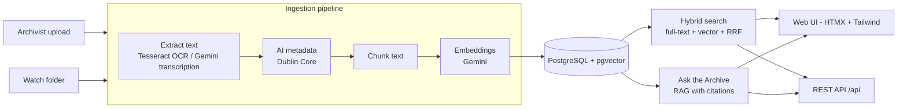

# ArchiveLens NL

**An AI-ready digital archive for Newfoundland and Labrador history.**

Upload scanned letters, newspapers, photographs and recordings. ArchiveLens turns them into organized,
searchable records: OCR or transcription → AI-generated Dublin Core metadata → chunking → embeddings
in PostgreSQL/pgvector. People can then browse, filter, search by meaning, and ask questions that are
answered only from the archive, with cited sources.

**Live demo:** https://archivelens-nl.onrender.com · **API docs:** https://archivelens-nl.onrender.com/docs

---

## Features

| Feature | How it works |
|---|---|
| Repeatable ingestion pipeline | One pipeline for every file: extract text → metadata → chunks → embeddings. Status: pending → processing → done/failed |
| OCR for scans | Tesseract. PDFs use their own text layer when present, and OCR scanned pages only |
| Audio/video transcription | Gemini transcribes recordings into searchable text |
| AI metadata | Gemini fills title, creator, date, subjects, people, places and a description (Dublin Core) |
| Human review | Archivists can correct AI metadata; corrections are never overwritten on re-processing |
| Duplicate detection | SHA-256 hash of each file; the same file is never stored twice |
| Watch folder | Files dropped into `data/watch/` are ingested automatically (inspired by IBM Content Aware Storage) |
| Hybrid search | PostgreSQL full-text search + pgvector semantic search, merged with Reciprocal Rank Fusion |
| Browse & filter | By type, subject tag and year range |
| Ask the Archive (RAG) | Retrieves the most relevant passages and answers with numbered citations |
| Archivist login | Public can browse; only archivists can upload, edit or delete |
| REST API | JSON endpoints with automatic OpenAPI docs at `/docs` |
| Offline mode | Without an API key, simple fallbacks keep everything working (used in tests) |
| Docker, tests, CI | Docker Compose for local runs, pytest suite, GitHub Actions on every push |

## Architecture



**Stack:** Python 3.12, FastAPI, SQLAlchemy 2, PostgreSQL 16 + pgvector, Google Gemini
(`gemini-2.5-flash`, `gemini-embedding-001` at 768 dimensions), Tesseract, PyMuPDF, Jinja2, HTMX,
Tailwind CSS, Docker Compose, pytest, GitHub Actions, Render, Supabase.

## Run it locally (Docker)

1. Install Docker Desktop.
2. `cp .env.example .env`, then set `ADMIN_PASSWORD`, `SECRET_KEY` and (optionally) `GEMINI_API_KEY`
   from [Google AI Studio](https://aistudio.google.com/apikey).
3. `docker compose up --build`
4. Open http://localhost:8000, log in at **Archivist login**, and upload a file.
   Or drop files into `data/watch/` and the watcher picks them up.

## Run the tests

```bash
docker compose up -d db
python -m venv .venv && source .venv/bin/activate
pip install -r requirements.txt
pytest -v
```

Tests run in offline mode (no API key). Database tests skip if PostgreSQL isn't running. OCR tests need Tesseract
(`brew install tesseract` on Mac).

## Deploy (free tiers: Supabase + Render)

1. **Database:** Create a Supabase project. Under **Connect**, copy the **Session pooler** connection string
   (works over IPv4) and put your database password in it. The app turns on the `vector` extension itself.
2. **GitHub:** Push this repo (check that `.env` is *not* committed).
3. **Render:** New → Blueprint → choose the repo (uses `render.yaml`), then fill in `DATABASE_URL`,
   `GEMINI_API_KEY` and `ADMIN_PASSWORD`.
4. Open the Render URL, log in, and upload your sample documents.

Note: Free Render instances sleep when idle (the first visit is slow) and their disk is temporary. Extracted
text, metadata and embeddings live in Supabase and are kept; original uploaded files may be lost on restart.
For production, originals would go to object storage (S3 or IBM Cloud Object Storage).

## API

| Method | Path | Purpose |
|---|---|---|
| GET | `/health` | Health check |
| GET | `/api/documents` | List items (optional `status`) |
| GET | `/api/documents/{id}` | One item with full text |
| GET | `/api/search?q=&doc_type=&subject=&year_from=&year_to=` | Hybrid search |
| POST | `/api/ask` `{"question": "..."}` | RAG answer with sources |

## Project structure

```
app/
  main.py         routes: web pages, admin, JSON API
  pipeline.py     ingestion pipeline (register → extract → metadata → chunk → embed)
  ocr.py          Tesseract OCR for images and scanned PDFs
  ai.py           Gemini: embeddings, metadata, transcription, answers (+ offline fallbacks)
  search.py       hybrid search, RRF, RAG retrieval
  models.py       tables: documents (Dublin Core) and chunks (vectors)
  db.py           database connection and setup
  watcher.py      watch-folder auto-ingest
  text_utils.py   cleaning, chunking, hashing, file types
  templates/      HTMX + Tailwind pages
tests/            unit + end-to-end tests
docs/             metadata standard, user guide, IBM CAS notes
```

## Documentation

- [Metadata standard](docs/METADATA_STANDARD.md): fields, file naming and clean-up rules
- [User guide for archivists](docs/USER_GUIDE.md): non-technical, step by step
- [Mapping to IBM Content Aware Storage](docs/IBM_CAS_MAPPING.md)

## Next steps

- Background queue (Redis + Celery) for large batches
- Object storage for originals; HNSW index on embeddings for large collections
- Page-level citations and image thumbnails
- Run the pipeline on IBM Content Aware Storage at scale

## About

Built by Arpita Bhattacharjee (MSc Computer Science, Memorial University of Newfoundland). 